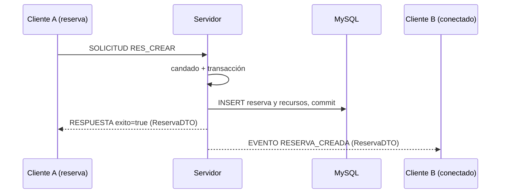

# Servidor de reservas, sesión, concurrencia y consultas (Integrante 2)

Documento técnico de la parte del servidor del Proyecto 2: servidor TCP multicliente, sesión por conexión, reservas con
transacción y candado, alertas, calendarización y programación de actividades. Complementa a `docs/00_contratos.md`, que
sigue siendo la referencia única de los mensajes.

## 1. Alcance

| Tema | Qué incluye |
|---|---|
| Servidor de red | `ServidorReservas`, `AtendedorCliente`, `GestorClientes`, `DespachadorPeticiones`, `ContextoSesion`, `Manejador` |
| Manejadores propios | `ManejadorAuth` (`AUTH_*`), `ManejadorReservas` (`RES_*`), `ManejadorCalendarizacion` (`CAL_CONSULTAR`), `ManejadorActividades` (`ACT_CONSULTAR`) |
| Reservas | `ReservaDatos` (JDBC), `ReservaLogica` (reglas, candado y transacción), `ReservaService` |
| Consultas | `CalendarizacionLogica`, `ProgramacionActividadesLogica` y sus `Service` |
| Cliente | `ProxyReservaService`, `ProxyCalendarizacionService`, `ProxyProgramacionActividadesService` |
| Protocolo | `MensajeRed`, `JsonRed`, `Operaciones`, `TipoMensaje` (módulo `comun`) |

Los manejadores de funcionarios, categorías y recursos son de Derek y los de estadísticas de Sofía; todos usan la misma
interfaz `Manejador` y se registran en `ServidorMain`.

## 2. Arquitectura

```
 Frontend (Presentación)                         Backend (Lógica + Datos)
┌──────────────────────────┐   TCP, JSON por línea   ┌──────────────────────────────────────────────┐
│ Vista (FXML)             │                         │ ServidorReservas ─ un hilo por cliente       │
│ Controlador (ui.*)       │      SOLICITUD ───────► │   AtendedorCliente                           │
│   usa IReservaService    │                         │     DespachadorPeticiones ─► Manejador       │
│        │                 │      ◄─────── RESPUESTA │         │                                    │
│   ProxyReservaService    │      ◄─────── EVENTO    │       Service ─► Logica ─► Datos ─► MySQL    │
│   (ProxyBase/ClienteRed) │                         │   GestorClientes difunde RESERVA_CREADA      │
└──────────────────────────┘                         └──────────────────────────────────────────────┘
```

- **Capas del Backend:** `Service` solo delega en la `Logica`; las reglas, validaciones y el manejo de transacciones viven en la
  `Logica`; el SQL vive en `Datos` (`PreparedStatement` siempre, sin concatenar valores).
- **Patrón Proxy:** la interfaz de servicio (`IReservaService`, `ICalendarizacionService`, `IProgramacionActividadesService`, en
  `comun`) la cumplen dos clases: el servicio real del Backend y el proxy del Frontend. El controlador solo conoce la interfaz.
  El proxy no tiene reglas: arma el mensaje, lo envía con `ProxyBase`, y convierte `exito=false` en `IllegalArgumentException`.
- **MVC:** Vista = FXML; Controlador = clases `ui.*Controller`; Modelo = DTO de `comun` y los servicios (reales o proxy).
- El Frontend no contiene reglas de negocio ni acceso a datos: el cálculo de la calendarización y de la programación se hace en
  el Backend y el cliente solo dibuja el resultado.

## 3. Servidor TCP

| Clase | Responsabilidad |
|---|---|
| `ServidorReservas` | Abre el puerto (`iniciar(puerto)`, acepta 0 para pruebas), acepta conexiones y lanza un hilo por cliente |
| `AtendedorCliente` | Un hilo por socket: lee una línea JSON, la despacha y escribe la respuesta. `enviar` es `synchronized` (respuestas y eventos no se mezclan). Un JSON inválido responde error y **no** cierra la conexión |
| `DespachadorPeticiones` | Mapa operación → `Manejador`. Devuelve **siempre** una `RESPUESTA` con el mismo `idSolicitud` |
| `ContextoSesion` | Sesión de una conexión (`LoginResultadoDTO`, `volatile`): `estaAutenticado`, `getRol`, `exigirAdministrador`, `iniciarSesion`, `cerrarSesion` |
| `GestorClientes` | Conjunto seguro de clientes conectados y difusión de eventos |
| `ServidorMain` | Lee el puerto de `servidor.properties` (5050 por defecto), registra los manejadores e inicia el servidor |

**Ciclo de una solicitud** (`DespachadorPeticiones.despachar`), en este orden:

1. Si el tipo no es `SOLICITUD` o falta la operación → error.
2. Sin sesión solo se permiten `AUTH_LOGIN` y `AUTH_CAMBIAR_CLAVE`; lo demás → "Debe iniciar sesión.".
3. Operación no registrada → "Operación no reconocida.".
4. Se llama al manejador. Un `datos` ausente o `null` llega como `null`.
5. `IllegalArgumentException` → `exito=false` con su mensaje (fallo de regla de negocio).
6. Un `ResultadoOperacionDTO` con `exito=false` se responde como error con su mensaje.
7. Cualquier otra excepción → se registra en el servidor y el cliente recibe "Error interno del servidor. Intente de nuevo.";
   los errores de SQL nunca viajan al cliente y la conexión sigue abierta.

## 4. Sesión y permisos

- `AUTH_LOGIN` guarda el `LoginResultadoDTO` en el `ContextoSesion` de **esa** conexión. `AUTH_LOGOUT` solo anula la sesión: el
  socket queda abierto y la conexión deja de recibir alertas.
- `RES_CREAR` **no recibe** el funcionario: usa el de la sesión, así que nadie puede reservar a nombre de otro.
- Un funcionario solo consulta (`RES_BUSCAR_ID`, `RES_BUSCAR_FUNCIONARIO`) y cancela (`RES_CANCELAR`) sus propias reservas; el
  administrador puede con cualquiera ("Solo puede acceder a sus propias reservas.").
- `RES_BUSCAR_PERIODO`, `CAL_CONSULTAR` y `ACT_CONSULTAR` están disponibles para cualquier sesión iniciada.
- Si el funcionario de la sesión no existe o fue dado de baja después de entrar, `registrarReserva` lo rechaza.

## 5. Reservas

### 5.1 Reglas (en `ReservaLogica`)

Actividad obligatoria y de 200 caracteres como máximo (la columna es `VARCHAR(200)`); fecha no pasada; horas dentro de 06:00 a
22:00, en bloques de 30 minutos y con inicio anterior al fin; al menos una categoría. Se asigna el **primer recurso libre** de
cada categoría: un recurso está libre si no tiene una reserva **activa** que se traslape en esa fecha (las canceladas no
ocupan). Si una categoría no tiene recurso libre, el mensaje nombra las categorías: "No hay recursos disponibles en las
categorías: Salas, Proyectores".

### 5.2 `registrarReserva`: candado y transacción

```
validarDatosGenerales (sin conexión)
synchronized (CANDADO_RESERVAS) {            // 1. primero el candado
    abrir conexión; setAutoCommit(false)     // 2. después la conexión
    ¿el funcionario existe y está activo?
    por categoría: filtrarRecursos + traslape → primer recurso libre
    generar ID con GeneradorIdsBD            //    SELECT ... FOR UPDATE
    INSERT reserva + INSERT reserva_recurso
    commit                                   // 3. commit ANTES de soltar el candado
}                                            //    si algo falla: rollback y se propaga el error
```

- **Atomicidad:** la reserva y todos sus recursos se guardan juntos o no se guarda nada.
- **Por qué el candado:** "buscar libre → guardar" son dos pasos; sin candado, dos clientes podrían quedarse con el mismo recurso.
  El candado (`ReservaLogica.CANDADO_RESERVAS`, `static final Object`) es compartido por **todas** las instancias.
- **Orden candado → conexión:** quien espera el candado no tiene ninguna conexión abierta ni bloqueos de MySQL. Así no puede
  formarse un bloqueo mutuo que MySQL no vería (un hilo con filas bloqueadas esperando el candado y otro con el candado
  esperando esas filas).
- **Commit antes de soltar:** el siguiente hilo que toma el candado ya ve la reserva guardada.
- **Bajas:** `RecursoLogica.eliminarRecurso` y la baja de funcionarios usan el mismo candado, así que no puede entrar una reserva
  entre "comprobar que no tiene reservas futuras" y "desactivar".
- El ID (`RES-000001`...) lo genera `GeneradorIdsBD` dentro de la transacción; las reservas canceladas cuentan (no se reutilizan).
- Una clave foránea inexistente (error 1452) se traduce a un mensaje claro; cualquier otro error de SQL queda como error interno.

### 5.3 Otras operaciones

`cancelarReserva` valida que exista, que no esté ya cancelada y que no sea de una fecha pasada. El cambio de estado es un solo
`UPDATE reserva SET estado = 'CANCELADA' WHERE id_reserva = ? AND estado = 'ACTIVA'` (`ReservaDatos.cancelarReservaActiva`).
MySQL bloquea la fila durante el `UPDATE`: si dos clientes cancelan la misma reserva a la vez, solo uno cambia la fila y el
otro recibe "Esta reserva ya se encuentra cancelada".
Las consultas por ID, funcionario y período salen de una sola consulta con `JOIN` (reserva, funcionario, recursos y categoría);
los recursos de una reserva se leen **sin** filtrar por `activo`, para que una reserva antigua conserve su recurso aunque esté
dado de baja.

## 6. Alertas: `RESERVA_CREADA`

Tras guardar, `ManejadorReservas` llama a `GestorClientes.difundirReserva(reserva, contexto)`. El evento lleva el `ReservaDTO`
completo y se envía solo a conexiones **autenticadas** y **distintas de la que reservó** (se compara por `ContextoSesion`).
Si no se puede armar el evento, se registra y la reserva sigue siendo exitosa; un fallo al escribir a un cliente no afecta a los
demás. El cliente de Sofía lo recibe en `ProcesadorAlertaReserva` y lo muestra en el panel de alertas.



## 7. Calendarización y programación de actividades

- `CAL_CONSULTAR {idCategoria, fecha}` → `CalendarizacionDTO { horas, recursos: [ { recurso, estados } ] }`, con un estado por
  cada hora (48 bloques de 30 minutos): `Disponible`, `Reservado - actividad - funcionario` o `Fuera de horario` (antes de las
  06:00 y desde las 22:00). Una categoría sin recursos devuelve la lista vacía.
- `ACT_CONSULTAR {fechaDesde, fechaHasta}` → `ProgramacionActividadesDTO { horas, actividadesPorFecha }`, donde la clave externa es
  la fecha `AAAA-MM-DD` y la interna la hora `HH:mm`; si dos reservas ocupan el mismo bloque se unen con una línea en blanco.
- El cálculo es lógica de negocio, así que vive en el Backend (`CalendarizacionLogica`, `ProgramacionActividadesLogica`). El
  cliente solo llena la tabla, y el PDF sigue generándose desde la tabla de la pantalla.

## 8. Concurrencia: resumen

| Elemento | Mecanismo |
|---|---|
| Atención de clientes | Un hilo por conexión; el hilo aceptador mantiene vivo el servidor |
| Registro de manejadores y clientes | `ConcurrentHashMap` y `ConcurrentHashMap.newKeySet()` |
| Sesión de una conexión | Campo `volatile` (lo escribe su hilo y lo lee el difusor) |
| Escritura al socket | `AtendedorCliente.enviar` es `synchronized` |
| Reservas y bajas | `CANDADO_RESERVAS` + transacción de MySQL |
| Cancelación de reservas | `UPDATE ... WHERE estado = 'ACTIVA'`: el cambio de estado es atómico en MySQL |
| Generación de IDs | `SELECT ... FOR UPDATE` dentro de la transacción |

## 9. Cómo ejecutarlo

1. MySQL 8 encendido y bases creadas con `bd/00_bases.sql`, `bd/01_schema.sql` y `bd/02_datos_iniciales.sql`
   (ver las notas de Derek sobre Workbench).
2. `backend/servidor.properties` y `frontend/config.properties` creados desde sus `.example` (no se suben a Git).
3. `mvn clean install` en la raíz.
4. Ejecutar `ServidorMain` y esperar "Servidor escuchando en el puerto 5050".
5. Abrir la app (`mvn -pl frontend javafx:run`), tantas veces como ventanas se necesiten. Sin servidor, la app muestra un aviso
   con Reintentar y Salir.

## 10. Pruebas de esta parte

| Prueba | Qué verifica |
|---|---|
| `ServidorReservasTest` (9) | Servidor real con sockets: mismo `idSolicitud`, errores de negocio y errores internos sin cerrar la conexión, sesión requerida, JSON inválido, `datos` nulo, varios clientes y difusión solo al otro cliente autenticado |
| `ContextoSesionTest` (5), `ManejadorAuthTest` (6) | Sesión por conexión, permisos de administrador, login, cambio de clave y logout |
| `ManejadorReservasTest` (10) | Identidad desde la sesión, propiedad de las reservas, datos faltantes e inválidos, difusión solo si se guardó |
| `ManejadorCalendarizacionTest`, `ManejadorActividadesTest` (5 + 5) | Datos que llegan a los servicios, errores y sesión |
| `DisponibilidadServiceTest` (23) | Traslapes, primer recurso libre, mensajes, `commit` y `rollback`, funcionario dado de baja, actividad vacía y límite de 200 caracteres |
| `ReservaCancelacionLogicaTest` (5), `ReservaDatosCancelacionTest` (2) | Cancelación: reserva activa futura, ya cancelada, inexistente o pasada; `UPDATE` condicionado a `ACTIVA` y cero filas afectadas |
| `ReservaDatosIT` (26) | SQL real en `reservas_test` con rollback: consultas, escritura con recursos, cancelación e IDs |
| `ReservaLogicaIT` (5) | **Concurrencia real:** 5 hilos piden el mismo recurso a la misma hora y solo uno lo consigue; dos cancelaciones simultáneas y solo una se confirma; funcionario inexistente o dado de baja |
| `CalendarizacionLogicaTest` (8), `ProgramacionActividadesLogicaTest` (4) | Matriz de estados, horario de servicio y mapa por fecha |
| `ProxyReservaServiceTest`, `ProxyCalendarizacionServiceTest` (7), `ProxyProgramacionActividadesServiceTest` (6) | Proxy con servidor TCP simulado: operación y datos enviados, conversión de DTO, errores |

Las pruebas `*Test` corren con `mvn test` y no necesitan MySQL; las `*IT` corren con `mvn verify` contra `reservas_test` (nunca
contra `reservas_db`) y se omiten si falta `backend/servidor-test.properties`.

## 11. Decisiones y límites conocidos

- **KISS y YAGNI:** sin pool de hilos, sin latidos ni reconexión automática; el cliente tiene un tiempo límite de 10 segundos por
  solicitud.
- **Cliente lento:** `difundirReserva` escribe a cada cliente en secuencia, así que un cliente que deja de leer puede retrasar la
  difusión. Se acepta por simplicidad.
- **Un solo servidor:** el candado de Java protege a un único proceso Backend; con varios servidores haría falta un bloqueo en la
  base de datos.
- **Claves:** el enunciado no pide cifrado de transporte; las claves viajan en el JSON del login y se guardan solo como hash
  (PBKDF2) en MySQL.
- **Alertas:** solo llegan mientras la sesión está abierta; no se guardan para quien se conecta después.
